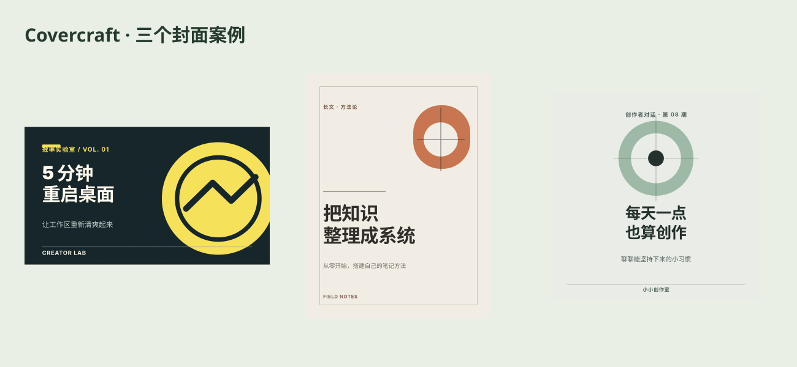

# Covercraft · 封面工坊

一个开源的社媒封面设计技能：让智能体从内容中提炼封面信息，并交付可编辑成品。附带可直接在浏览器运行的演示设计台，支持视频、文章、播客封面，导出 SVG 和 PNG。



## 立即体验

直接打开 [`web/index.html`](web/index.html)，或者运行本地静态服务器：

```bash
python3 -m http.server 8000
```

随后访问 `http://localhost:8000/`。无账号、无 API Key、无构建依赖。Google Fonts 无法访问时会自动使用系统字体；字体差异可能影响换行，导出前请检查预览。

设计台提供三种原创 SVG 构图、四种画布比例、实时预览、小尺寸预览和 SVG/PNG 下载。它是可编辑的基础设计工具；技能可指导智能体结合用户素材创作更复杂的封面。

## 在智能体中安装

技能目录是 [`skills/covercraft/`](skills/covercraft/SKILL.md)。复制整个目录，保留 `SKILL.md` 和 `references/`。

- **Codex**：复制到项目的 `.agents/skills/covercraft/`，或用户目录 `~/.agents/skills/covercraft/`。新会话中可说“用 covercraft 为这篇文章设计封面”。
- **Claude Code**：复制到项目的 `.claude/skills/covercraft/`，或 `~/.claude/skills/covercraft/`。
- **Claude 网页端**：把 `covercraft/` 文件夹打成 ZIP，在支持自定义技能的账号中从设置里的 Skills 功能上传。具体入口和可用性以当前账号界面为准。
- **WorkBuddy**：运行 `npm run workbuddy` 生成 `platforms/workbuddy/covercraft/`，再在技能市场选择“添加技能 / 上传技能”，上传该文件夹或打包的 ZIP。生成版包含 WorkBuddy 所需的展示字段。
- **其他支持 Agent Skills 的应用**：导入 `skills/covercraft/` 目录；若只支持贴入提示词，可使用下方的示例请求并把 `SKILL.md` 作为应用指令。

安装路径与上传方式参考 [OpenAI 技能说明](https://developers.openai.com/api/reference/cli)、[Claude Agent Skills 文档](https://platform.claude.com/docs/en/agents-and-tools/agent-skills/overview) 和 [WorkBuddy 技能文档](https://open.workbuddy.cn/docs/skill)。

## 用法示例

> 用 covercraft 为一条“5 分钟重启桌面”的视频设计封面。受众是居家办公者，做一个醒目的横版版本。先给两种不同方向，再交付可编辑 SVG 和 PNG，并检查缩略图可读性。

> 给一篇关于个人知识管理的文章做封面。调性安静、有编辑感，标题是“把知识整理成系统”。请给 3:4 和 1:1 两个版本，保持同一视觉语言。

三个虚构演示见 [`examples/`](examples/)：视频、文章、播客。点击网页中的案例卡片可加载并修改。示例 SVG 由 `npm run examples` 使用网页同一渲染函数生成。

## 目录

```text
skills/covercraft/   跨平台技能入口和设计参考
web/                 纯静态交互演示
examples/            从同一渲染器生成的案例 SVG
scripts/             案例生成与检查脚本
```

## 发布网页

将仓库推送到 GitHub 后，可在仓库 Settings → Pages 选择“Deploy from a branch”，从默认分支的根目录发布。根目录的 `index.html` 会跳转到 `web/`。如部署到其他静态托管平台，直接把整个仓库作为静态站点即可。

## 开发与验证

```bash
npm run examples
npm run check
npm run workbuddy
```

`npm run check` 只用 Node 标准库。开发者若安装了 Codex 的 skill-creator，可额外用其 `quick_validate.py` 验证 `skills/covercraft/`。

## 当前范围

网页端使用原创几何图形与排版，没有照片上传、AI 生图、自动理解文章或云端存储；这些能力留给安装技能的智能体及其现有工具。画布尺寸是演示预设，正式发布前应核对目标平台的最新要求与 UI 遮挡区域。SVG 文字使用系统字体，跨设备外观可能略有不同。

欢迎提交问题和改进。代码与示例采用 [MIT License](LICENSE)。
