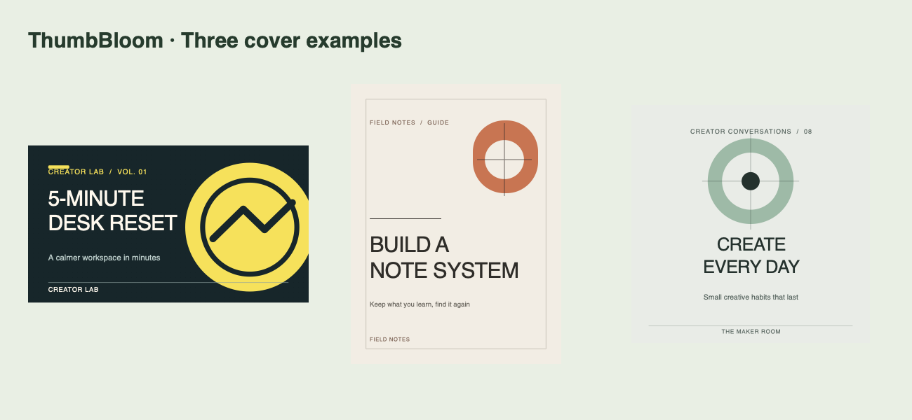

# ThumbBloom

**An open-source cover design skill for creators.** ThumbBloom helps an AI agent turn a video, article, podcast, or series brief into distinct cover concepts and an editable final design. It prioritizes truthful copy, readable hierarchy, appropriate crops, and checks at thumbnail size.

[简体中文说明](README.zh-CN.md) · [Skill instructions](skills/thumbbloom/SKILL.md) · [Three cover examples](examples/overview.png)



## What is included

- A portable Agent Skill in [`skills/thumbbloom/`](skills/thumbbloom/SKILL.md), with English as the default output language and Chinese available on request.
- Three fictional, editable SVG examples: a video thumbnail, an article cover, and a podcast cover.
- A dependency-free Node renderer that regenerates the examples. It is a reusable starting point, while the skill can use an agent's existing image or design tools for richer work.
- A WorkBuddy-specific skill variant generated from the same instructions.

## Install the skill

Copy the entire `skills/thumbbloom/` folder, including `references/`:

- **Codex:** `.agents/skills/thumbbloom/` in a project, or `~/.agents/skills/thumbbloom/` for your user.
- **Claude Code:** `.claude/skills/thumbbloom/` in a project, or `~/.claude/skills/thumbbloom/` for your user.
- **Claude web:** ZIP the `thumbbloom/` folder and upload it through the custom Skills feature if your account supports it.
- **WorkBuddy:** Run `npm run workbuddy`, then import `platforms/workbuddy/thumbbloom/` as a folder or ZIP through its Skill upload flow.
- **Other Agent Skills hosts:** Import `skills/thumbbloom/` and keep its folder structure.

The installation routes follow the current [OpenAI](https://developers.openai.com/api/reference/cli), [Claude](https://platform.claude.com/docs/en/agents-and-tools/agent-skills/overview), and [WorkBuddy](https://open.workbuddy.cn/en/docs/skill) documentation. Check the host's current interface when installing.

## Try it

> Use ThumbBloom to design a 16:9 cover for a five-minute desk reset video aimed at remote workers. Show two distinct concepts, choose one, and deliver editable SVG plus PNG. Check legibility at thumbnail size.

> Design matching 3:4 and 1:1 covers for an article about building a personal note system. Keep the tone editorial and the content promise accurate.

For Chinese output, add **“Please respond and write the cover copy in Simplified Chinese.”** The skill loads its optional Chinese localization reference when needed.

## Reproduce the examples

```bash
npm run examples
npm run workbuddy
npm run check
```

Only Node.js is needed; there are no runtime packages or API keys. The checked-in SVGs are editable in vector tools. `npm run check` verifies canvas dimensions, generated examples, text escaping, and consistency between the core and WorkBuddy skill instructions. Font rendering may vary by device; inspect exports before publishing.

## Repository layout

```text
skills/thumbbloom/          Portable skill and design references
platforms/workbuddy/       WorkBuddy metadata variant
examples/                  Three SVG covers and an overview image
scripts/                   Example renderer and checks
```

## Scope

The renderer uses original shapes and typography. It does not fetch images, generate photos, read articles automatically, or store creator content. The skill can guide an agent that has those capabilities. Canvas sizes in the examples are starting points; verify each platform's current requirements and UI overlays before publishing.

Code and examples are released under the [MIT License](LICENSE). Contributions and issue reports are welcome.
